# Portplanner — designbeskrivning

Beskriver utseendet på portplanner.se så att det går att återskapa på andra delar av
Portplanner (admin-portalen, medlemsportalen, e-post, PDF). Källan är `www/css/style.css`
och `www/index.html`.

Kapitel 1–10 beskriver sajten som den ser ut idag. Kapitel 11 definierar det som sajten
saknar men som en applikationsyta behöver. Kapitel 12 listar kända brister.

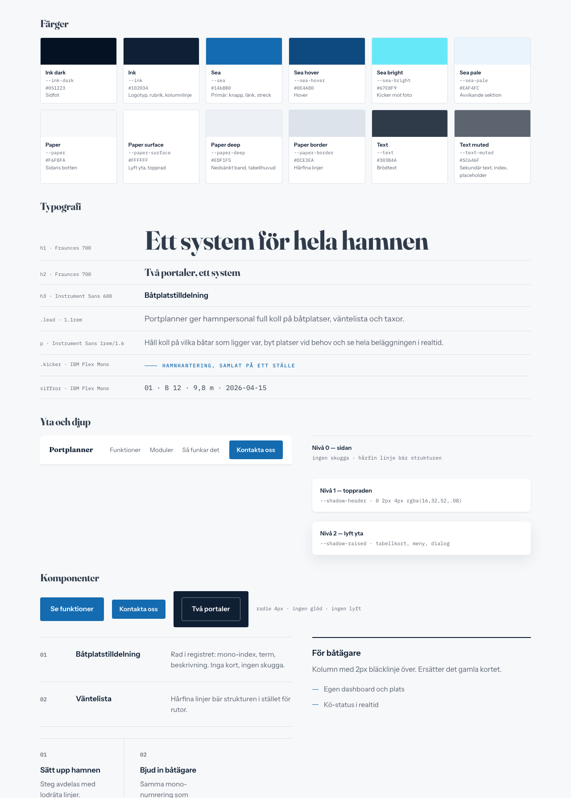

## 1. Designidé

Tre ord: **bläck, papper, sjögrön**. Uttrycket är ett **register**, inte en broschyr.

Ytan är ett svalt, nästan vitt papper med en gnutta blått i sig. Texten är mörk blågrå,
inte svart. Den enda
starka färgen är en mättad sjöblå som bara används på det som är klickbart eller viktigt.
Strukturen bärs av hårfina linjer — inte av kort, rutor och skuggor. Allt som är en siffra
sätts i mono: platsnummer, mått, steg, datum. Rubrikerna sätts i en serif med karaktär,
allt annat i en neutral grotesk. Mellan innehållsblocken ligger fullbreda hamnfoton som
ger rytm; de bär ingen information.

Innehållet är vänsterställt. Sidan ska läsa som hamnkontorets egen liggare, inte som en
generisk SaaS-sajt.

**Det här gör vi inte**, för att uttrycket ska hålla:

- Inga kort där en linje räcker. Skugga betyder att något ligger *ovanpå* sidan, aldrig
  att något är viktigt (kapitel 4).
- Inga runda ikonplattor i pastell, inga pillformade knappar, ingen färgad glöd.
- Inga påhittade sifferrader ("2 portaler · 1 system · 0 excelark").
- Ingenting som tonas in när man rullar, och ingen parallax.
- Ingen centrerad brödtext.

## 2. Färg

| Token | Värde | Hex | Används till |
| --- | --- | --- | --- |
| `--ink-dark` | `oklch(18% 0.040 255)` | `#051223` | Sidfot |
| `--ink` | `oklch(24% 0.045 255)` | `#102034` | Logotyp, rubriker, kolumnlinje |
| `--sea` | `#146bb0` | `#146BB0` | Primärfärg: knapp, länk, streck, kicker |
| `--sea-hover` | `#0e4a80` | `#0E4A80` | Hover och aktivt läge |
| `--sea-bright` | `#67e8f9` | `#67E8F9` | Kicker, **endast** mot mörkt foto |
| `--sea-pale` | `#eaf4fc` | `#EAF4FC` | Avvikande sektion |
| `--paper` | `#f6f8fa` | `#F6F8FA` | Sidans botten |
| `--paper-surface` | `#ffffff` | `#FFFFFF` | Lyft yta: topprad, kort, fält |
| `--paper-deep` | `#edf1f5` | `#EDF1F5` | Nedsänkt band: tabellhuvud, zebrarad |
| `--paper-border` | `#dce3ea` | `#DCE3EA` | Hårfina linjer |
| `--text` | `oklch(35% 0.030 255)` | `#303B4A` | Brödtext |
| `--text-muted` | `oklch(50% 0.020 255)` | `#5C646F` | Sekundär text, mono-index, placeholder |

De blå och pappersstegen är satta i hex, textfärgerna i oklch. Nya textnyanser sätts i
oklch med ton 255.

**Pappersstegen är kall, och det är ett val.** Förut var pappret varmt benvitt
(`#FAF4EC`) medan accentbandet var ljusblått — två olika temperaturer som drog åt var
sitt håll. Nu ligger allt på samma blågrå axel: vit → `#F6F8FA` → `#EDF1F5`, med
`#EAF4FC` som det enda tonade bandet. Samma familj som bokamera.se använder
(`#fff` / `#f8fafc` / `#f0f2f4`), men med vår egen sjöblå i botten i stället för en
färdig gråskala. Det vi förlorar är sjökortspappers-värmen; det vi vinner är att
sjöblått inte längre ser kallt ut mot sin egen bakgrund.

**Regler**

- En primärfärg. `--sea` på knappar, länkar, streck och aktiva lägen — inget annat ska
  konkurrera.
- `--sea-bright` fungerar bara mot mörk bild. Mot papper är den oläslig.
- Två textvikter räcker: `--text` för innehåll, `--text-muted` för sekundärt och för
  placeholder. Den tidigare `--text-faint` är borttagen — den klarade inte AA och fanns
  bara som en fälla.

Uppmätt mot `--paper`: brödtext 10,7:1 · `--text-muted` 5,6:1 · `--sea` 5,3:1 · vit text
på `--sea` 5,6:1. Mot `--paper-deep` (lägst i stegen): 10,0 · 5,3 · 4,9:1. Mot sidfotens
bläck: rubriker 6,2:1 · länkar 11,6:1 · krediter 7,1:1. Allt klarar WCAG AA.

## 3. Typografi

Tre typsnitt, alla från Google Fonts:

- **Fraunces** 600/700 — `--font-display`. Endast h1, h2 och ordmärket.
- **Instrument Sans** 400/500/600 — `--font`. Brödtext, h3, nav, knappar, allt annat.
- **IBM Plex Mono** 400/500 — `--font-mono`. Siffror och etiketter: kicker,
  registerindex, stegnummer, platsnummer, mått, datum, tabellrubriker.

Mono-användningen är poängen. Platsnummer och mått är Portplanners innehåll, och när de
sätts i mono kommer uttrycket ur domänen i stället för ur dekoration.

| Roll | Storlek | Övrigt |
| --- | --- | --- |
| h1 | `clamp(2.3rem, 4.6vw + 1rem, 3.7rem)` | Fraunces 700, `opsz 120`, `line-height: 1.1`, `letter-spacing: -0.015em` |
| h2 | `clamp(1.8rem, 2.4vw + 1rem, 2.5rem)` | som h1 |
| h3 | `1.05rem` | Instrument Sans 600, färg `--ink` |
| Brödtext | `1rem` | `line-height: 1.6`, färg `--text-muted` |
| Lead | `1.1rem` | max `54ch` |
| Listor, registertext | `0.96rem` | |
| Kicker | `0.72rem` | mono, versaler, `letter-spacing: 0.14em` |
| Etikett, tabellrubrik | `0.68rem` | mono, versaler, `letter-spacing: 0.12em` |

h1 och h2 har `text-wrap: balance`, vilket jämnar ut radbrytningen och hindrar ensamma
ord på sista raden.

Fraunces är en rubrikskärning. Den används aldrig under h2, och aldrig i tabeller,
etiketter, knappar eller formulär.

## 4. Rum, yta och djup

| Token | Värde |
| --- | --- |
| `--max-width` | `1180px` |
| Sidomarginal (`.wrap`) | `24px` |
| Sektionshöjd | `104px` upptill och nedtill, `72px` under 620px |
| `--radius-sm` | `4px` — knappar, fält, pills |
| `--radius` | `8px` — större ytor, kort i portalen |
| `--shadow-header` | `0 2px 4px rgba(16,32,52,.08)` — toppraden |
| `--shadow-raised` | `0 1px 2px rgba(16,32,52,.05), 0 12px 32px rgba(16,32,52,.08)` — lyft yta |

**Skugga betyder nivå, aldrig betoning.** Tre nivåer, inga fler:

| Nivå | Vad | Uttryck |
| --- | --- | --- |
| 0 | Sidan själv: sektioner, register, steg, kolumner | Ingen skugga. Hårfina linjer bär strukturen. |
| 1 | Toppraden | `--shadow-header` |
| 2 | Det som flyter ovanpå sidan: tabellkort, mobilmeny, dropdown, dialog | `--shadow-raised` |

En rubrik, en knapp eller ett register får aldrig skugga för att dra till sig blicken.
Skuggorna är mjuka och breda snarare än korta och täta — bokameras kortskugga är 37px
oskärpa på 16% svärta, och det är den karaktären som är värd att ta efter: lyft papper,
inte materialhöjd. Färgen är `rgba(16,32,52,…)`, vår bläckton, inte neutralt svart —
svart mot kallt papper blir grådaskigt.

Mellanrummen rör sig i steg om ungefär 6 / 10 / 14 / 22 / 44 px.

## 5. Komponenter

**Kicker** (`.kicker`) — mono i versaler med ett 28px streck före, ovanför rubriken.
Ersätter den gamla pillformade eyebrow-knappen. Mot foto används `.kicker-light`
(`--sea-bright`).

**Knapp** (`.btn`) — `13px 22px`, radie 4px, vikt 600. `.btn-primary` är `--sea` med vit
text och byter till `--sea-hover`. `.btn-ghost` är genomskinlig med vit ram, endast mot
foto. Ingen skugga, ingen förflyttning vid hover.

**Register** (`.register`) — funktionslistan. Varje rad är mono-index, term och
beskrivning i tre kolumner, avdelade med 1px linjer. Det här är sajtens
grundkomponent och mönstret att återanvända när något ska räknas upp.

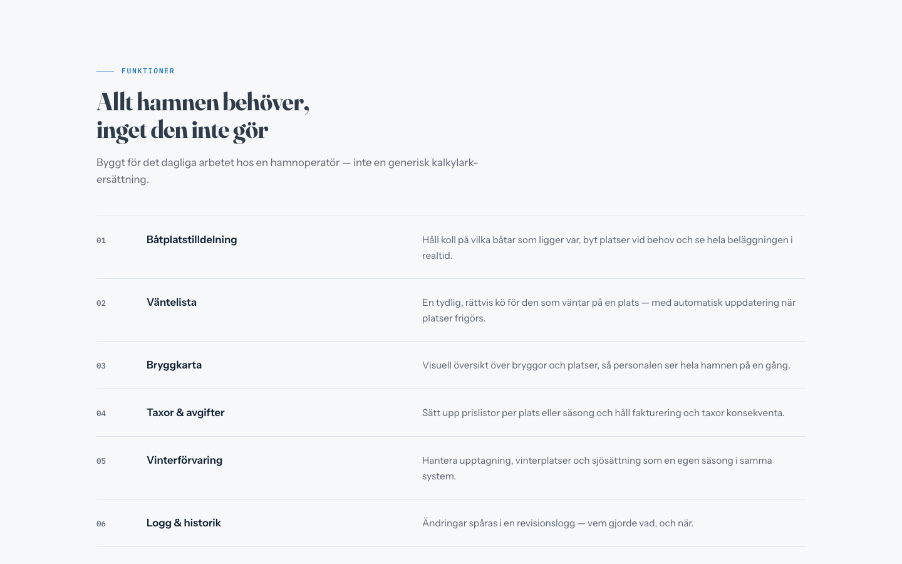

**Kolumn** (`.column`) — rubrik och text under en 2px `--ink`-linje. Ersätter kort när två
saker ska ställas bredvid varandra.

**Prickar** (`.ticks`) — punktlista där punkten är ett 14px `--sea`-streck i stället för
en bullet.

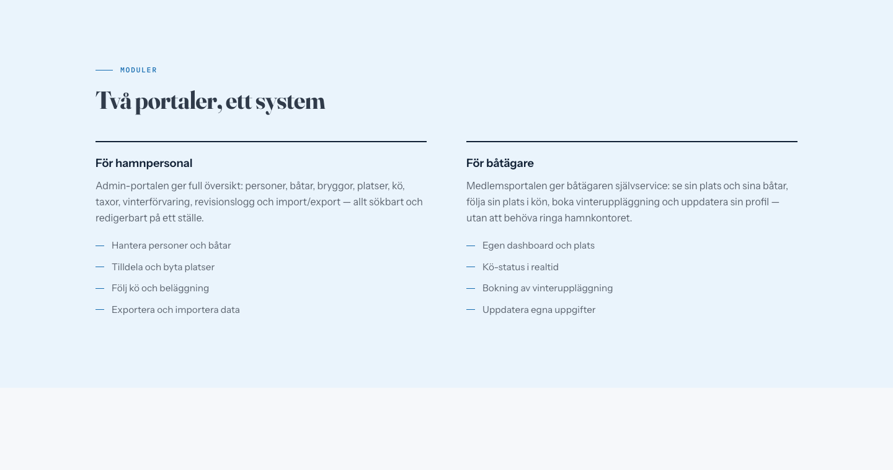

**Steg** (`.steps`) — tre spalter avdelade med lodräta linjer, var och en med mono-nummer,
rubrik och text. Under 980px blir de en lodrät lista med vågräta linjer.

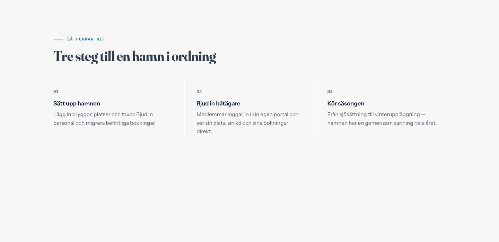

**Topprad** (`.site-header`) — se kapitel 6; den har egna regler.

**Sidfot** — `--ink-dark`. Rubriker i mono-versaler, länkar i Instrument Sans. Text vit
med opacitet: rubriker .55, länkar .78, brödtext .72, krediter .6.

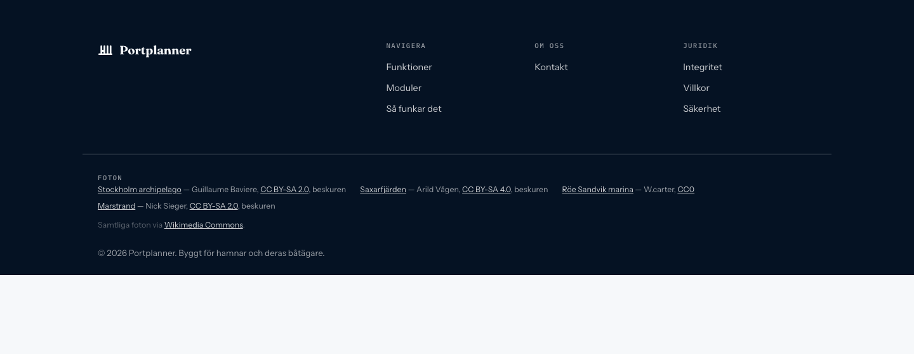

**Fokusring** — `outline: 2px solid var(--sea)` med 2px offset på `:focus-visible`,
globalt. Mot foto byts den till `--sea-bright`.

## 6. Topprad och meny

Toppraden är byggd efter bokamera.se, som löser exakt samma problem: en smal rad som ska
ligga kvar över en lång säljsida och samtidigt rymma vägen in i systemet. Det här är taget
därifrån, och varför.

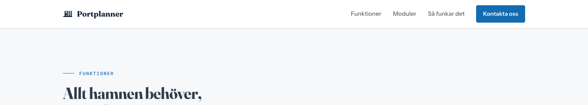

**Opak yta med skugga — inte genomskinlig med ram.** Headern låg tidigare som
`rgba(253,251,249,.86)` med `backdrop-filter: blur(12px)` och en linje under. Nu är den
vit (`--paper-surface`) med `--shadow-header` och ingen ram. Tre skäl: blurren blir grumlig
när den ligger över hero-fotot, som är mörkt; den tvingar fram ett eget compositor-lager
vid varje scroll; och den är i sig en av de mest utslitna gesterna. En hårfin skugga säger
samma sak — *det här ligger ovanpå* — utan någon av kostnaderna. Geometrin är bokameras
(`0 2px 4px` på 8% svärta), tonen är vår.

**Sticky, inte fixed.** bokamera använder `position: fixed` och får då kompensera med
toppmarginal på innehållet. Vår hero är ett fullbrett foto som ska börja direkt under
raden; `sticky` ger samma beteende utan att något behöver offsettas. En regel mindre att
bära med sig till portalerna.

**Tre zoner: märke, navigation, handling.** Märket till vänster, navlänkarna skjutna åt
höger med `margin-left: auto`, och längst ut en handlingszon (`.header-actions`). Det är
bokameras viktigaste grepp — de har *Mina bokningar · Admin login · Skapa bokningssystem*
där — och det passar Portplanner, som har samma form: två portaler plus en väg in.

Idag ligger bara **Kontakta oss** där, för det är den enda knappen som leder någonstans på
riktigt (`mailto:`). Zonen är reserverad för *Logga in* och *Mina båtplatser* när
portalernas adresser finns. Regel: **högst en fylld knapp** i raden; övriga blir sekundära
eller rena länkar, annars tävlar de med varandra.

**Mobilen: låda plus skärmsläck.**

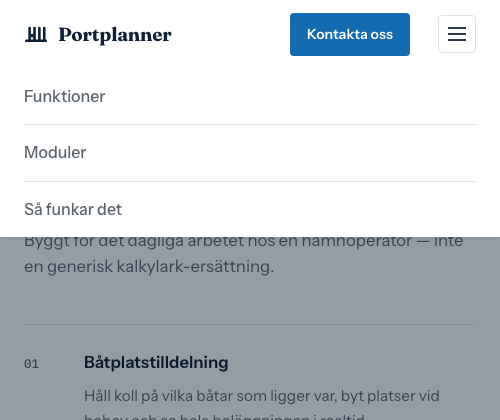

Under 760px fälls navlänkarna ihop till en låda som fälls ut under raden
(`max-height` 0 → 320px, 0,25s), och en helskärmsyta (`.nav-dimmer`) lägger sig över sidan
på 40% bläck. Lådan stängs av: klick på skärmsläcket, klick på en länk, Escape, eller
hamburgaren igen. Efter stängning går fokus tillbaka till hamburgaren.

Skärmsläcket är `visibility` + `opacity`, inte `display: none`. Det är skillnaden mot
bokameras egen variant, där `display` byts samtidigt som opaciteten ska tona — och då
händer ingen toning alls.

Brytpunkten är 760px, inte sidans 620px: tre länkar plus knappen tar slut på plats runt
700px, långt innan layouten gör det.

**Där vi avviker medvetet.** bokamera centrerar märket på mobil och lägger hamburgaren
till vänster. Vi behåller märket till vänster och hamburgaren längst till höger — märket
hör hemma där läsningen börjar, och reglaget där tummen är. Knappen stannar kvar i raden
på mobil i stället för att vikas in i lådan, eftersom den är sidans enda riktiga handling.

**Samma rad i portalerna.** Mönstret gäller rakt av: vit rad, `--shadow-header`, märke till
vänster, flikar till höger, användarens handlingar längst ut. Den aktiva fliken markeras
med `--sea-pale` som botten, inte med ett understreck. Se `app-yta.html`.

## 7. Ikoner

Sajten har inga ikoner utöver ordmärket — registret och stegen klarar sig på text och
linjer, och det är avsiktligt.

Där ikoner behövs (portalerna) gäller: `24×24`-rutnät, ingen fyllning,
`stroke: currentColor`, `stroke-width: 1.6`, runda ändar och hörn. Det sätts globalt på
`svg` i stilmallen, så en ny ikon ärver det. Ikoner är ett tillägg till text, aldrig en
ersättning.

Ordmärket är en brygga sedd från sidan, `64×64` med `stroke-width: 7`, plus en fylld punkt
som båt. Fristående fil: `bilder/portplanner-mark.svg` — den ärver textfärgen via
`currentColor`.

## 8. Foto

Tre foton: ett i hero och två som fullbreda band mellan sektionerna. Varje foto har alltid
ett gradientlager över sig, aldrig bart:

```css
background:
  linear-gradient(200deg, rgba(14,74,128,.62) 0%, rgba(14,74,128,.66) 55%, rgba(5,18,35,.78) 100%),
  url("../assets/images/marina-roe-sandvik.jpg") center 68% / cover no-repeat;
```

I hero går gradienten i sidled (mörkast till vänster, där texten ligger) i stället för
nedåt. Gradienten har två jobb: hålla vit text läsbar och dra fotot in i paletten.

Banden är `aria-hidden="true"` och har inget innehåll — de är rytm, inte information.
Fotona kommer från Wikimedia Commons under CC BY-SA/CC0 och **kräver attribution**;
krediterna ligger i sidfoten. Ett nytt foto måste krediteras på samma sätt.

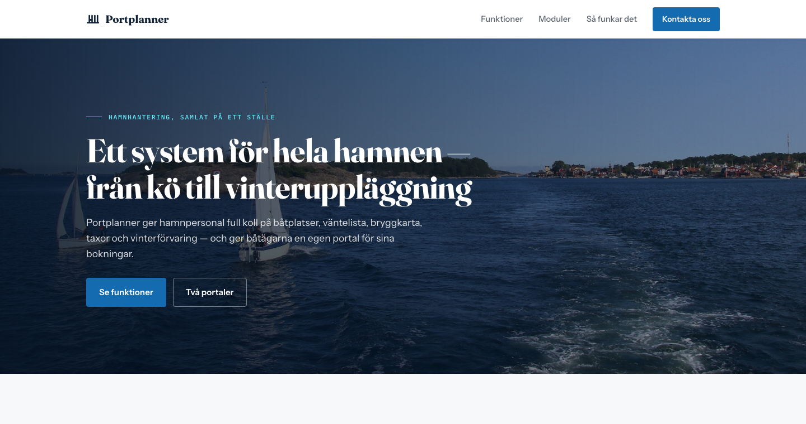

## 9. Rörelse

Nästan ingen. Knappar och länkar byter färg på 0,15s. Inget tonas in, ingenting rör sig
när man rullar, och ingen bakgrund är låst till vyn.

`prefers-reduced-motion: reduce` nollar ändå all animation, alla övergångar och mjuk
rullning. Den regeln ska följa med till varje ny yta.

## 10. Responsivt

Tre brytpunkter.

**≤ 980px** — registret lägger beskrivningen under termen med index kvar till vänster,
stegen blir en lodrät lista, de två kolumnerna staplas och sidfotsnavet blir två spalter.

**≤ 760px** — toppraden fälls ihop: hamburgare, utfällbar låda och skärmsläck (kapitel 6).
Bara menyn, ingenting annat.

**≤ 620px** — allt i en spalt, sektionerna krymper till 72px och hero till 96/84px.

Rubrikerna skalar steglöst med `clamp()`, så det behövs inga egna rubrikstorlekar per
brytpunkt.

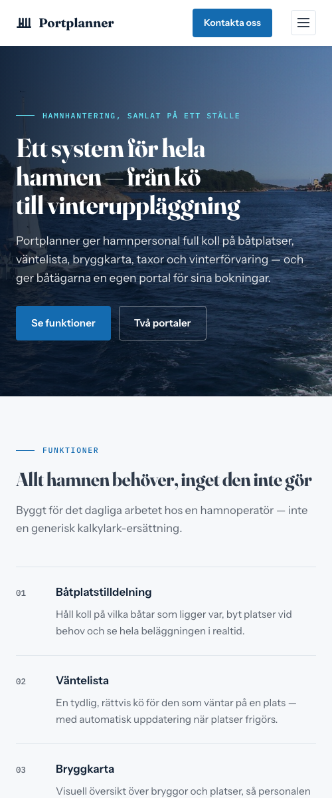

## 11. Att ta med till portalerna

Sajten är en marknadssida. Admin- och medlemsportalen är täta dataytor.

**Behåll**

Paletten, de tre typsnitten och deras roller, hårlinjerna, mono på alla siffror,
vänsterställningen, den fyrkantiga knappen och fokusringen.

**Skala om**

Sektionsrytmen. 104px mellan block blir 24–32px på en datayta. Registret blir en tabell,
men behåller mono-index och linjerna.

**Lämna kvar på sajten**

Fullbreda foton, hero-gradienten och Fraunces i rubriker över h2. En portal ska se ut som
ett verktyg.

**Definieras här** (finns inte på sajten idag)

Statusfärger, formulärfält, tabell och den sekundära knappen. Levande referens:
[`app-yta.html`](app-yta.html) — öppna den i en webbläsare, den läser sajtens riktiga
stilmall.

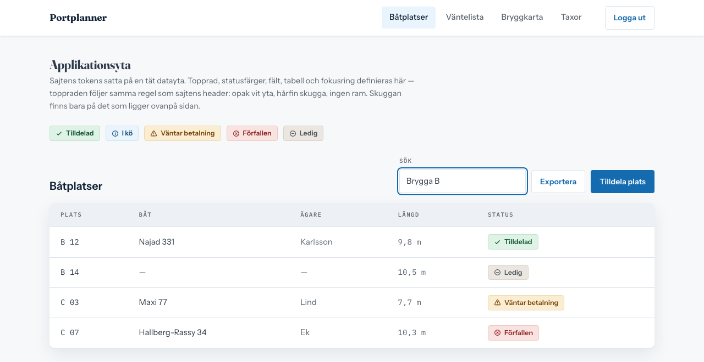

| Roll | Text | Botten | Kant |
| --- | --- | --- | --- |
| Klar, tilldelad, aktiv | `#0F5132` | `#DEF2E5` | `#C2E4D0` |
| Pågår, i kö, info | `#0E4A80` | `#EAF4FC` | `#CFE3F5` |
| Väntar, delvis, varning | `#77450A` | `#FBEDD2` | `#EEDAB0` |
| Fel, förfallen, avvisad | `#8E1F1F` | `#F9E3E1` | `#EFC9C5` |
| Ledig, vilande, neutral | `#4C545F` | `#EBE7E0` | `#D8D3CA` |

Alla fem klarar WCAG AA mot sin egen botten (6,2–8,2:1). Reglerna:

- Grön betyder klar, röd fel, gul mittemellan, grå neutral. Samma betydelse överallt.
- Färg aldrig ensam. En pill har alltid text; ikonen är ett tillägg — statusen ska gå att
  läsa i gråskala.
- Mjuka toner, inte full mättnad. Starka pills blir outhärdliga i en lång tabell.
- Pillarna behöver sin kantlinje. Bottnarna ligger med flit nära pappret och syns annars
  knappt.

**Fält** — `--paper-surface` botten, 1px `--paper-border`, radie 4px, `9px 12px`,
`0.92rem`. Etikett över fältet i mono-versaler `0.68rem`. Placeholder i `--text-muted`.

**Tabell** — ligger i ett kort på `--paper-surface` med radie 8px och `--shadow-raised`,
utan ram: skuggan gör ramen överflödig, och de två tillsammans blir smutsigt. Rubrikraden
är `--paper-deep` med mono-versaler `0.68rem`, raderna avdelas med 1px `--paper-border`
och radhover är `--paper`. Platsnummer, mått och datum i mono; sekundära värden i
`--text-muted`.

**Topprad** — se kapitel 6. Aktiv flik på `--sea-pale`, hover på `--paper-deep`.

## 12. Kända brister

- `assets/og-image.png` refereras av fyra metataggar men finns inte i repot. Alla
  delningar av sajten saknar förhandsbild.
- `sailboat-archipelago.jpg` och `sunset-archipelago.jpg` används inte längre men ligger
  kvar i `www/assets/images/` och deployas till S3.
- Vilket Commons-foto som är `hero-archipelago.jpg` är inte dokumenterat. Både
  "Stockholm archipelago" och "Saxarfjärden" står kvar i krediterna tills det är klarlagt.
- Inget mörkt läge finns. Sajten är ljus-bara; en portal som vill ha mörkt läge måste
  definiera en egen uppsättning ytfärger — paletten här räcker inte.
- Tre typsnittsfamiljer laddas från Google Fonts. Det är en extern beroendekedja och
  kostar några hundra kB vid första besöket.

## Beslutsunderlag

Typsnittsvalet gjordes genom att rendera fyra riktningar på Portplanners eget innehåll:
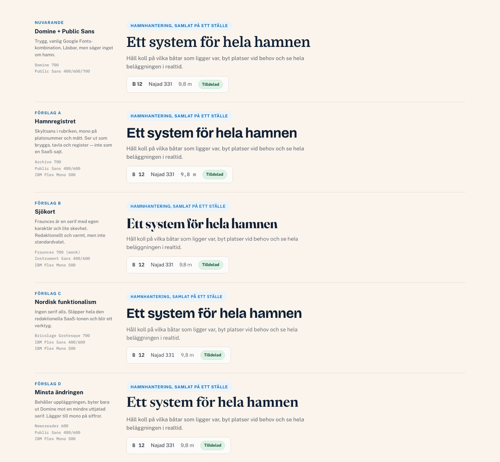

Toppraden, skuggorna och den svala pappersstegen är hämtade från **bokamera.se**, efter att
ha läst deras publicerade stilmallar i stället för att gissa utifrån en skärmbild. De
värden som faktiskt togs därifrån: `box-shadow: 0 2px 4px #00000014` på headern, den breda
mjuka kortskuggan (`37px` oskärpa, 16% svärta), och bakgrundsfamiljen
`#fff` / `#f8fafc` / `#f0f2f4`. Allt annat — fixed, centrerat märke på mobil, pillformade
val-knappar, Poppins — är medvetet inte taget. Avvikelserna står i kapitel 6.
